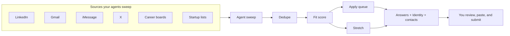

<p align="center">
  <picture>
    <source media="(prefers-color-scheme: dark)" srcset="brand/nixfred-logo.svg">
    
  </picture>
</p>

<h1 align="center">NixNet Job Command</h1>

<p align="center">
  <strong>Your agents find the jobs. This system organizes, tracks, and preps.<br>You still click submit.</strong>
</p>

<p align="center">
  
  
  
  
  
</p>

<p align="center">
  <picture>
    <source media="(prefers-color-scheme: dark)" srcset="brand/nixfred-icon.svg">
    
  </picture>
</p>

NixNet Job Command is a **scaffold**, not a bot that applies for you. You bring your own AI agents (or your own eyes) to hunt. This app is the command center they dump into: one queue, one Stretch lane, custom answers for every posting, company limits, receipts, hiring-manager contacts, and a daily progress graph you can screenshot for a mentor or for friends and family.

It is a local Python and SQLite web app. No cloud account, no telemetry, no pip dependencies to run it. Default bind is `127.0.0.1:8742`.


---

## This is a scaffold. Bring your own agents.

A job hunt dies in two places: you cannot find enough of the right roles, and you stall when it is time to apply. Most tools try to "auto-apply." That is a good way to get rejected, and a great way to violate a company's "no automation / no AI-submitted applications" rule.

NixNet Job Command takes the other path.

- **Agents hunt.** They read LinkedIn, Gmail, texts, X, career boards, and startup lists, then post roles into the tracker.
- **The system organizes.** Dedupe, fit scores, company caps, Stretch vs. the main queue, and a next-up apply flow.
- **The system preps.** Per-job answers, a portable 1Password Identity, a contact card, a receipt slot.
- **You submit.** A human opens the real form, reviews the answers, pastes, and clicks. That is the whole point.

If you want a robot to fire applications into the void, this is not that. If you want to run a serious search at volume without getting sloppy, you are in the right repo.

---

## Harvest like it matters

A job search is a pipeline. If you only apply to whatever is still in your tabs, you are leaving warm paths and new postings on the floor. The harvest is the job. The apply session is the payoff.



**Why harvesting hard matters:**

- **Volume.** A serious search needs a full queue, not five bookmarked tabs. This app is built to hold hundreds of roles and still feel like a to-do list.
- **Speed.** New postings and recruiter pings go stale in days. A daily sweep keeps the queue fed so an apply session never starts from zero.
- **Warm paths.** A lead from friends and family, a recruiter DM, or a "we're hiring" post is not the same as a cold board. Capture the source, keep the referrer, and apply while the path is still warm.
- **Hot leads jump the line.** Set `hot: true` (and optionally `due_label` or `due_at`) on a job and it gets a red HOT badge, sorts to the top of the queue, and shows an "apply by hand before ..." callout.
- **Never drop a lead.** A weak fit, a low band, or the wrong city is still a role you may want. It goes to **Stretch**, not the trash. Former-employer rules and company caps are explicit, not vibes.

### Where the roles come from

Your agents (or you) can pull from all of this:

- **LinkedIn:** job links, saved searches, recruiter DMs, and posts that say "we're hiring."
- **Gmail:** application receipts auto-matched back to the job card, recruiter mail, and job alerts.
- **iMessage:** leads texted in by friends and family. Those are often the warmest paths in the whole search.
- **X:** hiring posts and threads you would otherwise lose in the timeline.
- **Company career boards:** Greenhouse, Ashby, Lever, and the rest. The ATS is recorded on the card so you know the form you are walking into.
- **Startup lists and outlier roundups:** batch imports, scored and queued the same as a single link.

**Job alerts, handled.** Alert emails (LinkedIn, Dice and Built In digests today) go straight in. Whoever has your mail hands the text to `POST /api/alerts/ingest`; the app parses each role, drops the ones you already track (same LinkedIn job id, same URL, or same company plus a near-identical title, in any status, so a role you closed never comes back), and triages the rest by title. Roles that look like your target work (solutions, forward deployed, applied AI) join the apply queue; everything else lands in Stretch with a reason. It remembers which emails it has read, so running it again is safe, and `dry_run` shows what would happen first.

```bash
curl -s localhost:8742/api/alerts/ingest -d '{"emails":[{"id":"<gmail id>","subject":"...","text":"<email body>"}],"dry_run":true}'
curl -s localhost:8742/api/alerts/seen        # email ids already read
```

Roles from alerts are triaged by title only and left unscored, so a person or agent should read the posting before spending an application on one.

Every inbound role hits the same pipeline: sweep, **dedupe** (same URL, or same company plus a near-identical title), **fit-score**, then **queue or Stretch**. Nothing is applied for you. Nothing is messaged for you.


The apply queue is a session, not a spreadsheet. Search it, skip a company until a date, open the real posting, copy answers, and mark applied. Keyboard included.


Stretch is the honest second lane. The role stays, the reason stays, and you can still apply. Move anything between Stretch and the main queue from the job page.

---

## Answers that sound like you, because they are built from your work

Custom answers are the difference between a form you dread and a form you finish. NixNet Job Command drafts, for every job:

- Why this company
- Why this role
- Why here
- Relevant experience
- A project you are proud of
- Plus the open-ended questions on that company's form


**Make them portfolio-aware.** Point your AI at your real proof: GitHub repos, personal sites, posts, case studies, and your resume. The engine in this repo reads a local `profile.json` of hooks and proof paragraphs, then weaves them into paste-ready answers for that JD. Your agent should keep that profile honest: no invented credentials, no placeholder voice, no generic "I am passionate about your mission."

You review, you edit, you paste, you own it. Amber answers are flagged when a fact is thin and needs your call.

---

## 1Password Identities: faster forms, still human

Connect 1Password and create custom **Identities** (legal name, contact, work history, links). When the application opens, you click the first field and let 1Password fill it. That is the grind, automated, without a bot touching the form.

This is how you go faster **without** breaking a company's "no automation / no AI-submitted applications" rule:

- **Autofill is your password manager**, a feature the site already expects humans to use. It is not a headless submitter.
- **AI preps the long answers.** You read them, edit them, and paste them. They are yours.
- **No bot submits the form.** There is no "Apply for me" button in this app. You open the official posting, you review, you click submit.
- **Receipts come back to the job card** so the tracker stays in sync with what you actually sent.

The job page walks that order: fill with your Identity, attach the resume, copy the answers, submit, paste the confirmation, mark applied.

---

## Know who to talk to

Each job can carry a **Who to contact** card: hiring manager, peers, recruiter. Research only. Nobody is messaged from this app. Your agent can look people up and store the results. You decide whether to reach out.


---

## Progress you can feel, and show

Applying is a habit, not a mood. The Progress page is built to keep you honest and to let you show the work.


- A **daily applications graph** from your reset day (first boot uses today, or set your own)
- A **running total** across the window
- **Streaks**, **best day**, and a **daily goal line** you can change on the page
- A **Prepare for screenshot** share card: chrome hides, the card stays, Esc brings the UI back

That share card is for a mentor, for friends and family, or for anyone who asked how the search is going. Accountability works better when the graph is real.


Company limits and skips live in the same system. If a company caps you at three applications per rolling 30 days, the app tracks the window, pauses the leftover roles, and tells you when the door opens again. Roles are not closed. They wait.

---

## What you get

- **Apply queue** with search, keyboard, and a next-up flow
- **Stretch** for roles you still want that are not a top fit
- **Custom answers** per JD, copy buttons, in-place edit
- **Gmail receipts** matched back to the job (the app does not send mail)
- **Company limits and Skip company**, with a reopen date
- **Progress graph**, goal, streak, best day, share card
- **Who to contact**, stored locally
- **Duplicate guard** on URL or company plus similar title
- **Answer library**, referrals, 1Password identity sheet, local screenshots, CSV/JSON export

All of it runs from a SQLite file in `data/`. Your real search never has to leave the machine.

---

## Quick start

Python 3.9 or newer. No packages to install.

```
git clone <this-repo>
cd nixnet-job-command
./setup.sh          # or: make setup
make run            # http://127.0.0.1:8742
```

`setup.sh` copies `config.example.toml` to `config.toml` and `profile.example.json` to `profile.json` if they are not already there, then creates `data/`. It will not overwrite your files.

The first boot loads a fictional seed (Acme Cloud, Globex AI, and friends) so the UI is not empty. Dates in the seed shift to today so the Progress graph has something to show. Replace `profile.json` with your own facts before you use any generated answer in a real application.

```
make test           # boots a temp database, hits /api/health, /api/jobs, /api/progress
```

Optional install units, with `__INSTALL_DIR__` placeholders:

- `contrib/nixnet-job-command.service` for a systemd user service
- `contrib/com.nixfred.nixnet-job-command.plist` for launchd

---

## Configure it for you

| File | What it is |
|---|---|
| `config.toml` | Port (default 8742), bind, timezone, daily goal, progress start, paths, database file name (`db_file`), branding (`logo`, `favicon`, `static_overlay`), `seed_path = "none"` to never seed |
| `profile.json` | Display name, proofs, company hooks, skills, fit rules, Identity sheet |
| `seed/example_seed.json` | Fictional first-run jobs. Your real jobs live in `data/njc.db` |
| `.env` | Optional. See `.env.example`. Never commit real keys |

Environment variables (`NJC_PORT`, `NJC_BIND`, `NJC_DATA`, `NJC_PROFILE`, and the older `JCC_*` aliases) override the file. The server refuses to bind `0.0.0.0` unless you set `NJC_ALLOW_PUBLIC_BIND=1`.

**Keeping the database off a network share.** SQLite and NFS do not mix. If the code lives on a share, point `data_dir` at a local folder. `db_file` lets you keep an existing database name, and a database that still has the older `fred_decides` answers column keeps working (the app reads both names), so you can switch code without migrating data and roll back by pointing launchd or systemd at the old folder.

**Running it under launchd on a Mac.** launchd's `/usr/bin/python3` is refused ("Operation not permitted") when the code sits on a network share, because macOS treats that as a protected network volume. An ssh session is not refused, which makes the failure easy to miss. Keep the share as the place you edit and commit, and run a local clone: `git clone <share>/job.command.center.nixnet ~/njc`, copy your `config.toml` and `profile.json` into it, point the plist's `ProgramArguments` and `NJC_ROOT` at the clone, then `launchctl bootout` and `bootstrap` (a plain `kickstart -k` does not re-read a changed plist). To ship an update: `git -c safe.directory='*' -C ~/njc pull`, then `launchctl kickstart -k gui/$(id -u)/<label>`. To roll back, put the old plist back and bootout/bootstrap again; the database is shared and compatible both ways.

Fit rules in the profile (`min_base_pay`, locations, kinds) are for you and your agents. The score on each job is stored on the card, not invented by the server on the fly.

Regenerate answers after you edit the profile:

```
python3 builder/gen_custom_answers.py --profile profile.json path/to/jobs.json
```

Or `POST /api/jobs/<ref>/custom-answers` with `{"force": true}`. Answers you already edited are left alone unless you force a rewrite.

---

## Brand

The hexagon and wordmark in `brand/` are the official nixfred marks, copied unmodified from the [nixfredOS brand standard](https://github.com/nixfred/nixfredOS/blob/main/brand/README.md). Do not recolor or redraw them. The Larry face belongs only on the i in `nixfred`. The hexagon always shows the `>_` prompt.

---

## Status

v0.3.7. Python 3.9+ and the standard library only. Issues and pull requests are welcome; see [CONTRIBUTING.md](CONTRIBUTING.md). The screenshots above use the fictional example seed, not real people or companies.

## License

[MIT](LICENSE) © 2026 Fred Nix. See [CONTRIBUTING.md](CONTRIBUTING.md) and [CHANGELOG.md](CHANGELOG.md).
